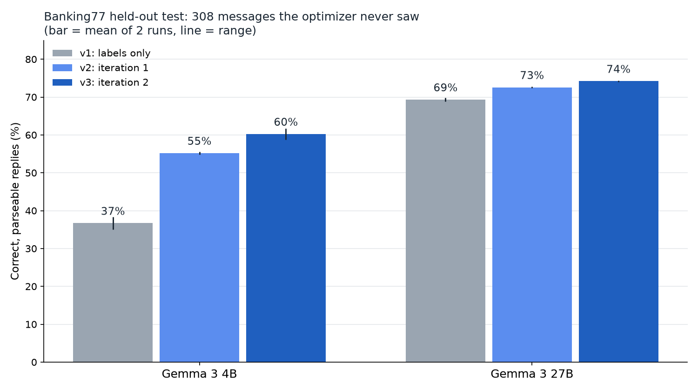
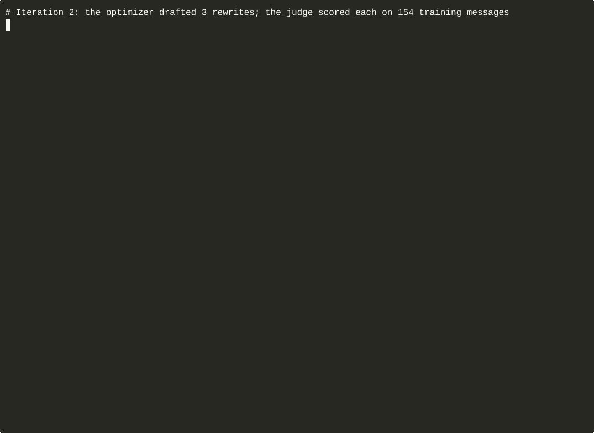

# PromptSloth 🦥

A lazy prompt that fixes itself on open-weight models, driven entirely over [AcruxCore](https://github.com/AcruxCore/AcruxCore)'s MCP server.



The router reads a bank customer's message and returns one of the 77 [Banking77](https://huggingface.co/datasets/PolyAI/banking77) intents. Version 1 of its prompt is the label list and one instruction. Two optimizer iterations rewrote it, and an open judge decided each promotion:

| Role | Model (all open-weight) |
|---|---|
| Router | Gemma 3 4B (Gemma 3 27B runs the finished prompts as a check) |
| Optimizer | gpt-oss-120b |
| Judge | Gemma 4 31B |

Held-out results, 308 test-split messages the optimizer never saw, mean of two runs. A reply counts when it is exactly the right label:

| Prompt | Gemma 3 4B | Gemma 3 27B |
|---|---|---|
| v1 (`lazy`): labels only | 37% | 69% |
| v2 (`fixed`): after iteration 1 | 55% | 73% |
| v3 (`fixed2`): after iteration 2 | 60% | 74% |

Iteration 1 fixed the reply format (the 4B model wrapped about 35% of v1 answers in braces). Iteration 2 added a one-line definition for each intent, and routing rose from 55% to 60% on the 4B model (exact McNemar p = 0.013). `python3 analyse.py` prints every number and test.



## Files

| File | What it does |
|---|---|
| `sample.py` | Downloads Banking77 and draws 154 train and 308 test messages (seed 42) into `data/splits.json` |
| `mcp.py` | A 40-line MCP JSON-RPC client |
| `promptsloth.py` | `setup`, `dataset`, `optimize`, `report`, `promote` and `eval`, each one an MCP tool call |
| `analyse.py` | Lenient and strict accuracy per cell, and an exact McNemar test per change |
| `chart.py`, `charts_extra.py` | Draw the charts in `images/` from `results/` |
| `results/` | Every held-out run and both optimizer reports behind the article |

The `results/` folder also holds Gemma 3 12B runs. They are left out of the tables because one upstream provider returned empty replies for that model.

## Run it

You need an AcruxCore API key with the editor role and the models registered in your team's gateway (the MCP server has no tool to register a model, so that step is one REST call or the dashboard).

```bash
pip install -r requirements.txt
export ACRUXCORE_API_KEY=...        # never commit it
python3 sample.py
python3 promptsloth.py setup
```

The full order, including both iterations, is in the docstring at the top of `promptsloth.py`.

## Data and licence

Banking77 is by PolyAI and is published under CC-BY-4.0 ([paper](https://arxiv.org/abs/2003.04807), [data](https://github.com/PolyAI-LDN/task-specific-datasets)). `data/splits.json` holds the sampled messages. The code is Apache-2.0.
